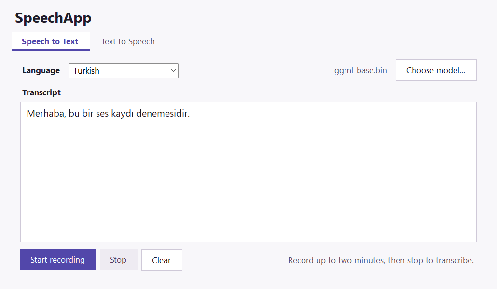
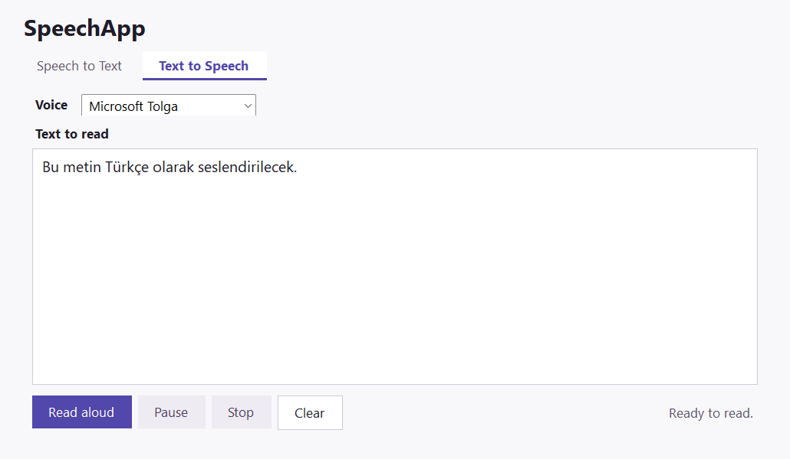

# SpeechApp

SpeechApp is a C# Windows Forms app for transcribing microphone recordings and reading text aloud. Both operations run locally.

## Features

- **Speech to Text** records up to two minutes from the default microphone and transcribes the recording in Turkish or English. You can cancel transcription, copy the transcript, or clear it.
- **Text to Speech** reads typed text with an installed Windows voice. You can choose a voice, pause, resume, stop, or clear the input.
- Each tool has its own tab. Switching tabs preserves both text fields and keeps the current audio activity visible at the top.

## Requirements

- Windows x64 and the .NET 10 SDK.
- [Microsoft Visual C++ Redistributable x64](https://learn.microsoft.com/en-us/cpp/windows/latest-supported-vc-redist) for the native Whisper runtime.
- A working default microphone for recording and an audio output device for playback.
- At least one compatible Windows speech voice for playback. The **Voice** list shows the voices available to the app.

## Run from source

From the repository root, run:

```powershell
dotnet run --project src/SpeechApp/SpeechApp.csproj
```

To enable transcription, download the [multilingual Whisper base model](https://huggingface.co/ggerganov/whisper.cpp/resolve/main/ggml-base.bin) (about 141 MiB). Select it with **Choose model**, or save it as `models/ggml-base.bin` before launching from the repository root. Text-to-speech works with an installed voice even before a model is selected.

## Use the app

1. In **Speech to Text**, choose **Turkish** or **English**, select **Start recording**, and speak into the default microphone. Select **Stop** to transcribe immediately, or wait for the recording limit. The result appears in **Transcript**.
2. In **Text to Speech**, enter text in **Text to read**, choose a voice, and select **Read aloud**. Use **Pause**, **Resume**, and **Stop** to control playback.

## Screenshots

### Speech to Text



### Text to Speech



## Implementation

- **Windows Forms** provides the two workspaces, input controls, and operation feedback.
- **Windows WinMM** captures 16 kHz mono audio in memory.
- **Whisper.net** and its CPU runtime transcribe the captured audio using a local GGML model.
- **System.Speech** reads text with installed Windows voices.

The form and entry point are in `src/SpeechApp/`. Microphone capture, transcription, and playback are in `src/SpeechApp/Audio/`.

## Limitations and troubleshooting

- Speech recognition starts after recording ends. Accuracy and processing time depend on the model, recording quality, and CPU.
- One audio operation can run at a time. Recordings are held in memory and discarded after processing.
- If recording fails, check the default microphone and allow desktop apps to access it in Windows microphone settings.
- If no voice appears, install a compatible Windows speech voice and restart the app. If transcription fails to start, check that the selected model is a multilingual GGML file and that the x64 runtime prerequisites are installed.
